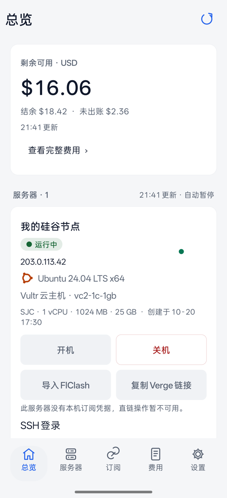
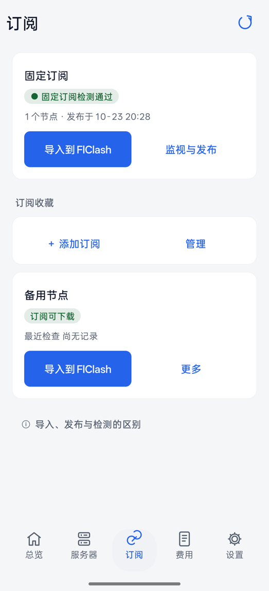
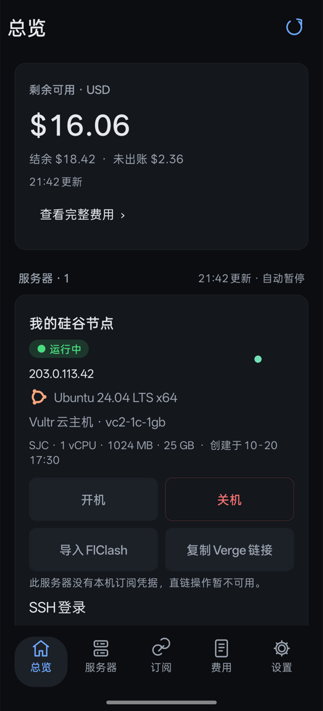

# Vultr 管家（Vultr Pocket）

在 Android 手机上管理个人 Vultr 云服务器的小工具：查看余额与账单、开关机、一键部署 Shadowsocks 节点并生成 Clash 订阅，配合 Cloudflare Worker 提供换服务器也不变的固定订阅地址。

*A personal Android app for managing Vultr servers: balance & billing, power control, one-tap Shadowsocks node deployment with a Clash subscription, and a Cloudflare Worker that serves a stable subscription URL. Chinese UI.*

<p>



</p>

> 截图来自离线预览包，数据均为虚构。

## 功能

- **总览**：剩余可用余额（已扣除未出账费用）、服务器运行状态、Cloudflare 固定订阅健康度。
- **服务器**：开机 / 关机（带确认与云端回读）、重装、删除；显示 SSH 登录信息与订阅直链。
- **一键部署**：按默认地区 / 套餐 / 月费上限新建 Ubuntu 实例，cloud-init 自动安装 Shadowsocks + nginx 订阅端点；每次部署随机生成订阅 token、节点密码和 SSH 密码。
- **订阅**：导入 FlClash、复制给 Clash Verge、多订阅合并、节点分层检测（端口 / 代理出口）。
- **分流模板**（`assets/config.yaml`）：国内直连、国外走代理，MRS 规则集每日更新；Claude/Anthropic 独立分组且没有直连选项，Tailscale（`*.ts.net`、`100.64.0.0/10`）直连，Apple 默认直连。
- **费用**：完整账单按产品汇总，标出当前实例的未出账费用，本机加密缓存。
- **刷新策略**：只读刷新在后台并行，不锁按钮；分级频率：服务器 60 秒、余额 5 分钟、固定订阅 15 分钟、账单 6 小时。

## 安全设计

- API Key、订阅地址、凭据都用 Android Keystore 加密保存在手机本地；正式版启用 `FLAG_SECURE` 防截屏。
- 新建、重装、删除、开关机都需要确认，并显示准确的名称、IP 和实例 ID；修改请求失败不会自动重发。
- 源码中不含任何密钥或固定密码。签名密钥在首次构建时于本机生成，不进仓库。

## 构建

需要：macOS 或 Linux、JDK 17+、Android SDK（`build-tools;35.0.0`、`platforms;android-35`）。项目不使用 Gradle，直接用 `aapt` / `javac` / `d8` 打包。

```bash
bash tools/fetch-mihomo.sh   # 下载官方 mihomo v1.19.33 Android ARM64 二进制并校验哈希
bash build.sh                # 输出 dist/Vultr-Pocket.apk；首次会在 signing/ 生成本机签名密钥
```

可选环境变量：`ANDROID_HOME`（默认 `~/Library/Android/sdk`）、`VULTR_JAVA_HOME`（JDK 11+，默认优先用 Homebrew 的 openjdk，其次 `JAVA_HOME`）、`VULTR_KEYSTORE_PASS`（签名密钥口令）。

首次打开 App，在「设置」里填入 Vultr API Key（需在 Vultr 控制台允许手机当前 IP 访问 API）。

## Cloudflare 固定订阅（可选）

`cloudflare/worker.mjs` 是一个只做配置分发的 Worker，节点流量不经过 Cloudflare。

```bash
cd cloudflare
cp wrangler.example.jsonc wrangler.jsonc        # 填入你自己的 KV namespace id
npx wrangler kv namespace create SUBSCRIPTIONS
npx wrangler secret put READ_TOKEN              # 只读订阅路径口令，建议 32 字节以上随机串
npx wrangler secret put ADMIN_TOKEN             # 发布接口口令
npx wrangler deploy
```

然后在 App「订阅 → 固定订阅 → 配置」中填入 Worker 地址、只读订阅 URL 和管理口令。国内网络下 `workers.dev` 域名常被干扰，建议绑定自己的域名。

## 目录

| 路径 | 内容 |
|---|---|
| `src/com/yjw/vultr/` | App 源码（Java，原生 View） |
| `assets/` | 服务器初始化脚本 `bootstrap.sh`、分流模板 `config.yaml` |
| `cloudflare/` | 固定订阅 Worker 及其测试 |
| `tests/` | 单元测试（`bash tests/run.sh`，需设置 `VULTR_TEST_JSON_JAR` 指向 org.json 的 jar） |
| `qa/` | 离线预览包（虚构数据、无联网权限）与截图验收脚本 |
| `tools/` | 分流维护、服务器订阅同步、mihomo 下载、Mac 上的 Claude 防直连（`mac-claude-guard/`） |
| `design-system/` | 界面设计规范 |
| `使用说明.md` | 详细说明与版本记录 |

## 声明

这是个人自用项目，按现状提供，不保证适用于任何特定用途。创建的云服务器会产生 Vultr 费用。请遵守所在地法律法规以及 Vultr、Cloudflare 等服务的使用条款。

## 许可证

[GPL-3.0](LICENSE)。内含 / 下载的第三方组件：mihomo（GPL-3.0，[源码](https://github.com/MetaCubeX/mihomo/tree/v1.19.33)）、SnakeYAML 2.4（Apache-2.0），见 `assets/legal/`。
